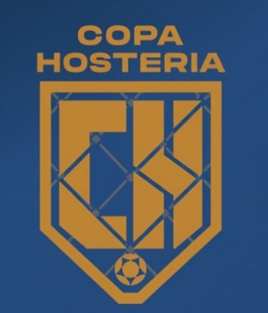

<div align="center">



# 🏆 Copa Hostería — 4° Edición

**Plataforma web oficial para la gestión integral del torneo Copa Hostería (28.11.2026).**  
Sorteo estilo FIFA con bombos, planilla de partidos en vivo, tabla de posiciones, estadísticas históricas, padrón de jugadores y exportaciones listas para compartir e imprimir.

[](https://copa-hosteria.vercel.app)


</div>

---

## ✨ Funcionalidades Principales

### 🎲 1. Sorteo Estilo FIFA con Bombos
- Organización de los **42 convocados** en bombos equilibrados (Bombos 1 al 7) para distribuir un jugador de cada bombo por equipo.
- Sorteo interactivo con asignación balanceada, edición de nombres y colores de camiseta.
- **Exportación inmediata para difusión y cancha:**
  - 💬 **Texto para WhatsApp** formateado con equipos y estrellas de campeón (`★`).
  - 🖼️ **Póster oficial en PNG** (1080px) con todos los planteles y el escudo del torneo.
  - 🃏 **Tarjeta individual en PNG por jugador** al momento de salir sorteado.
  - 📄 **Planilla de equipos en PDF** lista para imprimir.

### ⚽ 2. Partidos y Planilla en Vivo
- Generación automática de fixture **todos contra todos** (*round-robin*).
- Control de estado por encuentro (`Pendiente`, `En vivo`, `Finalizado`) con indicador en vivo en la barra superior.
- Registro en tiempo real de **goles, asistencias, amarillas, doble amarilla y rojas directas**.
- Detección automática de **expulsiones y suspensiones** para el partido siguiente.
- Descarga de **planilla oficial por partido (PDF)** y **fixture completo (PDF)** diseñados para el planillero.

### 📊 3. Tablas, Estadísticas y Palmarés
- **Tabla de posiciones** actualizada automáticamente (`PJ`, `G`, `E`, `P`, `GF`, `GC`, `DG`, `PTS`).
- Rankings de **goleadores, asistencias y disciplina**, con vista filtrable entre **4° Edición (2026)** e **Histórico acumulado** (Ediciones 1, 2, 3 y 4).
- **Palmarés oficial** del torneo con fecha y campeón de cada edición.

### 👥 4. Padrón de Jugadores
- Editor completo de futbolistas: nombre, posición (*Arquero, Defensor, Mediocampista, Delantero*), estrellas de campeón, historial de goles y convocatoria actual.
- Carga y recorte de **fotos de perfil** almacenadas en Supabase Storage (o localmente en desarrollo).

### 🔐 5. Vista Pública vs. Modo Organizador
- **Vista Pública:** cualquier jugador o espectador puede seguir el sorteo, los partidos, las tablas y el padrón en tiempo real sin riesgo de modificar datos.
- **Modo Organizador:** acceso protegido por PIN desde `/api/organizer/auth` con **bloqueo permanente por IP tras 3 intentos fallidos**, persistido en base de datos.

---

## 🏅 Palmarés Oficial

| Edición | Fecha | Campeón |
| :---: | :---: | :--- |
| **1° Edición** | 13/01/2024 | 🏆 **GOLF IS NOT FOR SALE** |
| **2° Edición** | 30/11/2024 | 🏆 **ORTO Y TETAS** |
| **3° Edición** | 06/12/2025 | 🏆 **LUCCA FC** |
| **4° Edición** | 28/11/2026 | ⏳ *En juego / Próximamente* |

---

## 🛠️ Stack Tecnológico

| Capa | Tecnología |
| :--- | :--- |
| **Framework** | [Next.js 16](https://nextjs.org/) (App Router) + [React 19](https://react.dev/) |
| **Lenguaje** | [TypeScript 5](https://www.typescriptlang.org/) |
| **Estilos y UI** | [Tailwind CSS 4](https://tailwindcss.com/), [Radix UI](https://www.radix-ui.com/), [Lucide Icons](https://lucide.dev/) |
| **Base de datos y Storage** | [Supabase](https://supabase.com/) (PostgreSQL JSONB + Storage Bucket) con fallback local en JSON |
| **Exportaciones** | [jsPDF](https://github.com/parallax/jsPDF) (PDFs oficiales) + HTML5 Canvas API (Póster y tarjetas PNG) |
| **Deploy** | [Vercel](https://vercel.com/) |

---

## 📁 Estructura del Proyecto

```text
copa-hosteria/
├── data/
│   └── copa-hosteria-db.json       # Base local de respaldo (modo desarrollo sin Supabase)
├── public/
│   ├── logo-copa-hosteria.jpg      # Escudo oficial del torneo
│   └── uploads/players/            # Fotos locales en desarrollo
├── supabase/
│   └── schema.sql                  # Script SQL para tabla y bucket en Supabase
└── src/
    ├── app/
    │   ├── api/
    │   │   ├── organizer/auth/     # Validación de PIN y bloqueo por IP
    │   │   ├── players/[id]/photo/ # Subida y actualización de foto de jugador
    │   │   └── state/              # Lectura, guardado y reinicio del estado del torneo
    │   ├── globals.css
    │   ├── icon.svg                # Favicon SVG con escudo del torneo
    │   ├── layout.tsx
    │   └── page.tsx
    ├── components/
    │   ├── CopaHosteriaApp.tsx     # Contenedor principal y navegación
    │   ├── DrawModule.tsx          # Sorteo estilo FIFA con bombos
    │   ├── LiveMatchModule.tsx     # Fixture y planilla en vivo
    │   ├── StatsModule.tsx         # Posiciones, rankings y palmarés
    │   ├── PlayersRosterModule.tsx # Padrón y editor de jugadores
    │   ├── OrganizerPinModal.tsx   # Modal de acceso organizador
    │   └── ui/                     # Componentes base (Radix + Tailwind)
    ├── lib/
    │   ├── db.ts                   # Capa de persistencia (Supabase / JSON local)
    │   ├── supabase.ts             # Cliente admin de Supabase
    │   ├── seed.ts                 # Datos oficiales precargados y palmarés
    │   ├── stats.ts                # Cálculos de tabla, rankings, suspensiones y fixture
    │   ├── export.ts               # Exportación WhatsApp, póster PNG y tarjeta PNG
    │   └── exportPdf.ts            # Exportación de planillas y fixture en PDF
    └── types/
        └── tournament.ts           # Tipos TypeScript del dominio
```

---

## 🚀 Instalación y Uso Local

### 1. Clonar el repositorio e instalar dependencias

```bash
git clone https://github.com/gonzalo-agostino/copa-hosteria.git
cd copa-hosteria
npm install
```

### 2. Configurar variables de entorno *(opcional en local, obligatorio en producción)*

Si no configurás Supabase, la app funciona automáticamente en local guardando el estado en `data/copa-hosteria-db.json` y las fotos en `public/uploads/players/`.

Para conectar **Supabase** (recomendado para producción en Vercel):

1. Creá un archivo `.env.local` a partir de `.env.example`:
   ```bash
   cp .env.example .env.local
   ```
2. Completá tus credenciales desde **Supabase → Project Settings → API**:
   ```env
   NEXT_PUBLIC_SUPABASE_URL=https://tu-proyecto.supabase.co
   SUPABASE_SERVICE_ROLE_KEY=tu-service-role-key
   ```
3. Ejecutá el script [`supabase/schema.sql`](supabase/schema.sql) en **Supabase → SQL Editor → Run** para crear la tabla `tournament_state` y el bucket público `player-photos`.

### 3. Iniciar el servidor de desarrollo

```bash
npm run dev
```

Abrí [http://localhost:3000](http://localhost:3000) en tu navegador.

---

## 📜 Scripts Disponibles

| Comando | Descripción |
| :--- | :--- |
| `npm run dev` | Inicia el servidor de desarrollo de Next.js |
| `npm run build` | Compila la aplicación para producción |
| `npm run start` | Inicia la aplicación compilada |
| `npm run lint` | Ejecuta ESLint sobre el proyecto |

---

<div align="center">

Hecho con ⚽ para la **Copa Hostería** · Nos vemos el **28.11.2026** en la cancha.

</div>
